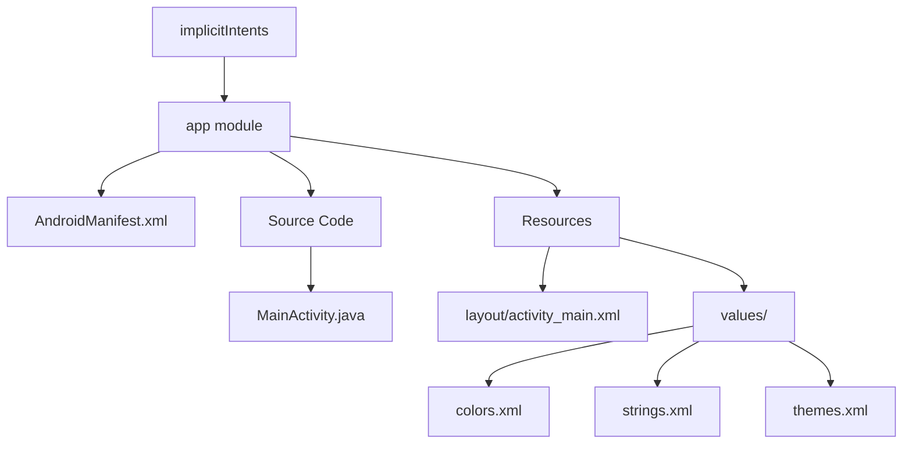

# Implicit Intents

An Android application demonstrating the use of **Implicit Intents** in Android (Java) to interact with external applications such as web browsers, map navigation apps, and text-sharing applications.

---

## 📱 Features

- 🌐 **Open Website**: Launches the default web browser to view the entered web address (`https://...`) using `Intent.ACTION_VIEW`.
- 📍 **Open Location**: Opens a map or navigation app to search for the entered location using `geo:0,0?q=` intents.
- 📤 **Share Text**: Shares custom text with other applications using `ShareCompat.IntentBuilder` and system share sheets.

---

## 🛠️ Project Structure

```
implicitIntents/
├── app/
│   ├── build.gradle.kts
│   └── src/
│       └── main/
│           ├── AndroidManifest.xml
│           ├── java/com/example/implicitintents/
│           │   └── MainActivity.java
│           └── res/
│               ├── layout/
│               │   └── activity_main.xml
│               └── values/
│                   ├── colors.xml
│                   ├── strings.xml
│                   └── themes.xml
├── build.gradle.kts
└── README.md
```

### Component Overview



- **`MainActivity.java`**: Contains intent handlers for opening websites, locations, and sharing text.
- **`activity_main.xml`**: Layout XML containing text fields and buttons for user interaction.
- **`colors.xml`**: Defines color resources used across the layout.
- **`strings.xml`**: Holds string constants for default input values and button labels.

---

## 🚀 Getting Started

1. Clone or open the project in **Android Studio**.
2. Sync the project with **Gradle**.
3. Run the application on an Android Virtual Device (AVD) or physical device running Android 7.0 (API level 24) or higher.
